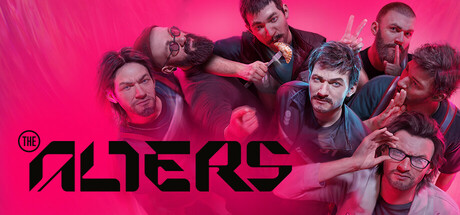

**The Alters by 11 bit studios (2025) is a survival base-building game where you clone versions of yourself from alternate life choices.**

---

## 📖 About

The Alters by 11 bit studios (2025) is a survival base-building game where you clone versions of yourself from alternate life choices. Each Jan alt has different skills shaped by different life decisions. Managing their psychological wellbeing while outrunning a planet's deadly sun is the core loop.

## ⚠️ Problems Without Trainer

| Problem | Status |
|---------|--------|
| Alters' psychological crises halt critical base operations at worst moments | ✅ Solved |
| Rapidium resource gathering races against sun approach leaving no preparation | ✅ Solved |
| Base module shortages force abandonment of key alt specialist roles | ✅ Solved |
| Jan Prime morale collapse triggers cascade failures across all alt production | ✅ Solved |
| Alternate life path exploration required for late-game alts is time-intensive | ✅ Solved |

## ✅ Solution

The **The Alters Trainer** solves all these issues, giving you complete control so you can focus on enjoying the game.

## 🎯 Features

- Unlimited Resources / Currency
- God Mode / Invincibility
- Instant Skill & Ability Cooldown
- One-Hit Kill
- Freeze Timers
- Unlock All Items & Achievements
- Custom Speed Multiplier
- Infinite Stamina / Energy

## 🚀 Quick Start

1. **Disable Windows Defender** temporarily (trainer may trigger false positive)
2. Get the trainer from the button above
3. Launch The Alters
4. Run the trainer as Administrator
5. Use the hotkeys to activate cheats in-game

## 💎 Free vs Pro

| Feature | Free | Pro |
|---------|------|-----|
| God Mode | ✅ | ✅ |
| Unlimited Resources | ✅ | ✅ |
| Advanced Cheats | ❌ | ✅ |
| Auto-Updates | ❌ | ✅ |
| Priority Support | ❌ | ✅ |

## 💻 Requirements

- Windows 10 / 11 (64-bit)
- The Alters (any version)
- .NET Framework 4.8+
- DirectX 11+

## 🍎 macOS

## ⚖️ Legal

Educational and single-player use only.

---

